# Python Cheat Sheet poster

A beginner-to-intermediate Python reference, as an 18 × 24 in wall poster in twelve colour themes. Every theme carries the same content; pick the one you want on your wall.

**[Open the preview page](https://bm16-gh.github.io/pythoncheatsheetposter/)** to browse the themes and download print files.

<table>
<tr><td align="center" width="25%"><a href="posters/18x24/Python-Cheat-Sheet_00-Night-Shift_18x24_300dpi.png">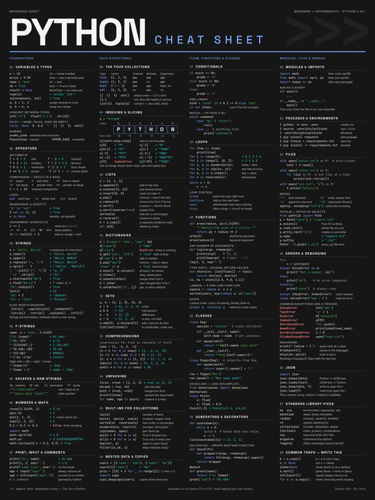</a> <b>00 · Night Shift</b> Charcoal with hairline rules and one cool blue. <a href="posters/18x24/Python-Cheat-Sheet_00-Night-Shift_18x24_300dpi.png">18×24</a> · <a href="posters/20x24/Python-Cheat-Sheet_00-Night-Shift_20x24_300dpi.png">20×24</a> · <a href="posters/20x30/Python-Cheat-Sheet_00-Night-Shift_20x30_300dpi.png">20×30</a></td><td align="center" width="25%"><a href="posters/18x24/Python-Cheat-Sheet_01-Tealline_18x24_300dpi.png">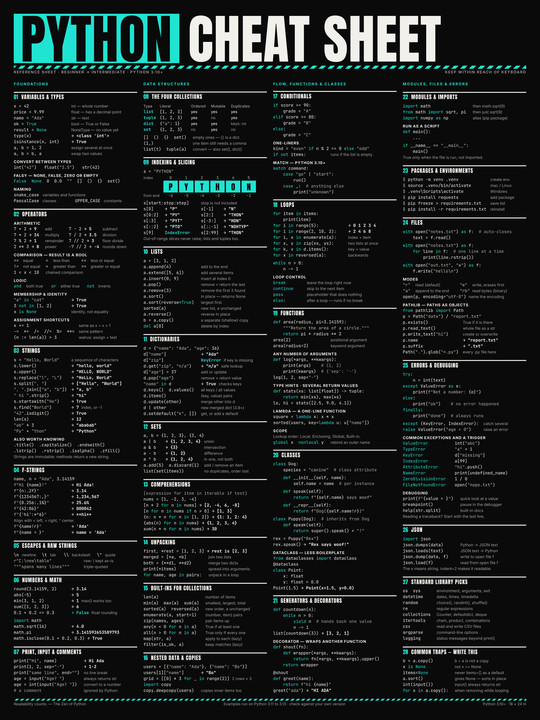</a> <b>01 · Tealline</b> Black and teal under a hazard stripe. <a href="posters/18x24/Python-Cheat-Sheet_01-Tealline_18x24_300dpi.png">18×24</a> · <a href="posters/20x24/Python-Cheat-Sheet_01-Tealline_20x24_300dpi.png">20×24</a> · <a href="posters/20x30/Python-Cheat-Sheet_01-Tealline_20x30_300dpi.png">20×30</a></td><td align="center" width="25%"><a href="posters/18x24/Python-Cheat-Sheet_02-Schematic_18x24_300dpi.png">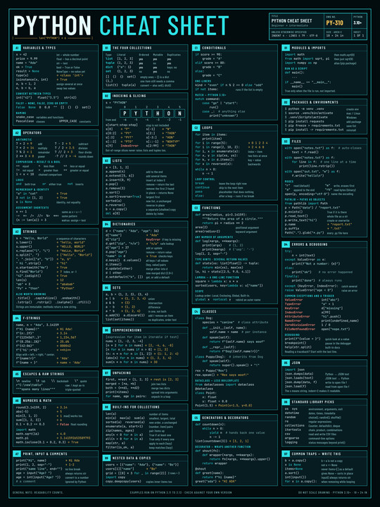</a> <b>02 · Schematic</b> Engineering drawing with a title block and amber results. <a href="posters/18x24/Python-Cheat-Sheet_02-Schematic_18x24_300dpi.png">18×24</a> · <a href="posters/20x24/Python-Cheat-Sheet_02-Schematic_20x24_300dpi.png">20×24</a> · <a href="posters/20x30/Python-Cheat-Sheet_02-Schematic_20x30_300dpi.png">20×30</a></td><td align="center" width="25%"><a href="posters/18x24/Python-Cheat-Sheet_03-Swiss-Grid_18x24_300dpi.png">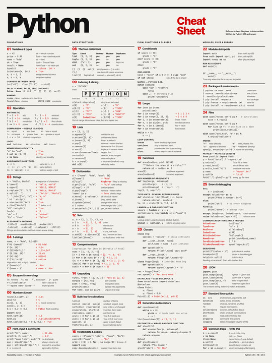</a> <b>03 · Swiss Grid</b> Warm paper, black grotesque type, one red. Light on ink. <a href="posters/18x24/Python-Cheat-Sheet_03-Swiss-Grid_18x24_300dpi.png">18×24</a> · <a href="posters/20x24/Python-Cheat-Sheet_03-Swiss-Grid_20x24_300dpi.png">20×24</a> · <a href="posters/20x30/Python-Cheat-Sheet_03-Swiss-Grid_20x30_300dpi.png">20×30</a></td></tr>
<tr><td align="center" width="25%"><a href="posters/18x24/Python-Cheat-Sheet_04-Neon-Arcade_18x24_300dpi.png">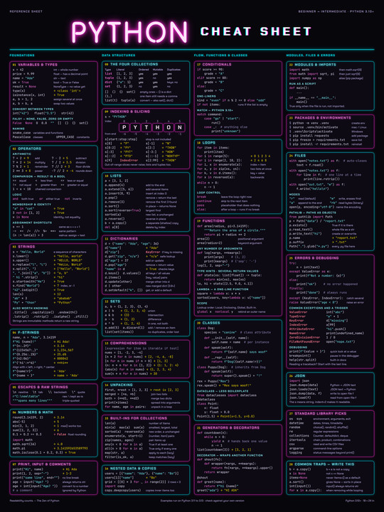</a> <b>04 · Neon Arcade</b> Glowing magenta and cyan panels on black. <a href="posters/18x24/Python-Cheat-Sheet_04-Neon-Arcade_18x24_300dpi.png">18×24</a> · <a href="posters/20x24/Python-Cheat-Sheet_04-Neon-Arcade_20x24_300dpi.png">20×24</a> · <a href="posters/20x30/Python-Cheat-Sheet_04-Neon-Arcade_20x30_300dpi.png">20×30</a></td><td align="center" width="25%"><a href="posters/18x24/Python-Cheat-Sheet_05-Notebook_18x24_300dpi.png">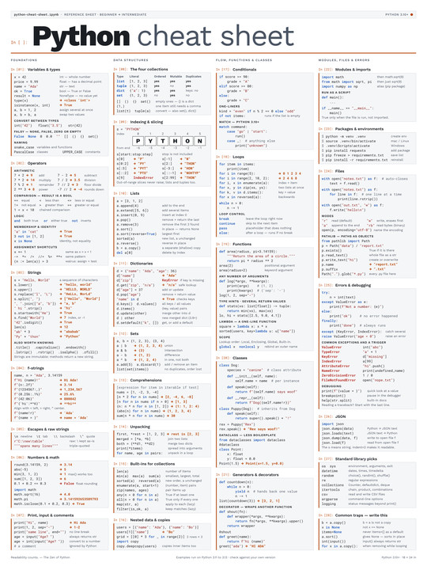</a> <b>05 · Notebook</b> White notebook page with grey code cells. Light on ink. <a href="posters/18x24/Python-Cheat-Sheet_05-Notebook_18x24_300dpi.png">18×24</a> · <a href="posters/20x24/Python-Cheat-Sheet_05-Notebook_20x24_300dpi.png">20×24</a> · <a href="posters/20x30/Python-Cheat-Sheet_05-Notebook_20x30_300dpi.png">20×30</a></td><td align="center" width="25%"><a href="posters/18x24/Python-Cheat-Sheet_06-Zen-Garden_18x24_300dpi.png">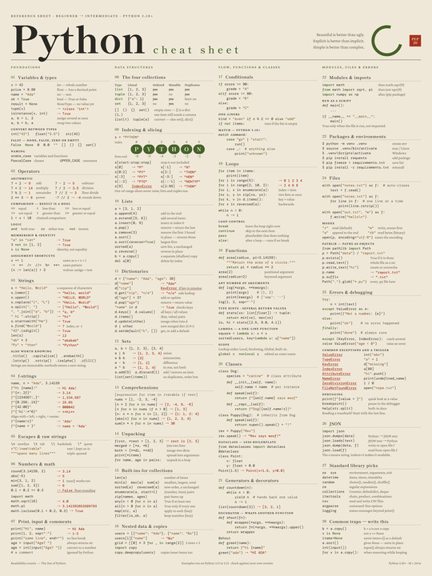</a> <b>06 · Zen Garden</b> Sand, ink and moss with a brush ring. Light on ink. <a href="posters/18x24/Python-Cheat-Sheet_06-Zen-Garden_18x24_300dpi.png">18×24</a> · <a href="posters/20x24/Python-Cheat-Sheet_06-Zen-Garden_20x24_300dpi.png">20×24</a> · <a href="posters/20x30/Python-Cheat-Sheet_06-Zen-Garden_20x30_300dpi.png">20×30</a></td><td align="center" width="25%"><a href="posters/18x24/Python-Cheat-Sheet_07-Playbill_18x24_300dpi.png">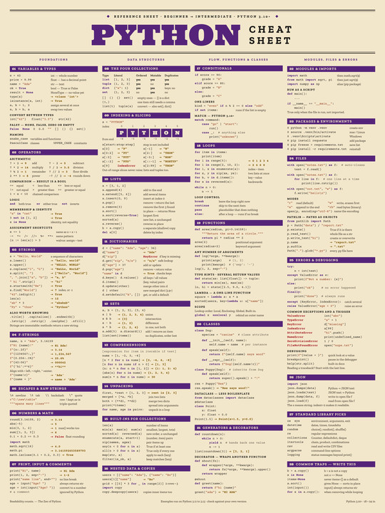</a> <b>07 · Playbill</b> Cream theatre bill in fat slab type and purple. Light on ink. <a href="posters/18x24/Python-Cheat-Sheet_07-Playbill_18x24_300dpi.png">18×24</a> · <a href="posters/20x24/Python-Cheat-Sheet_07-Playbill_20x24_300dpi.png">20×24</a> · <a href="posters/20x30/Python-Cheat-Sheet_07-Playbill_20x30_300dpi.png">20×30</a></td></tr>
<tr><td align="center" width="25%"><a href="posters/18x24/Python-Cheat-Sheet_08-Chalkboard_18x24_300dpi.png">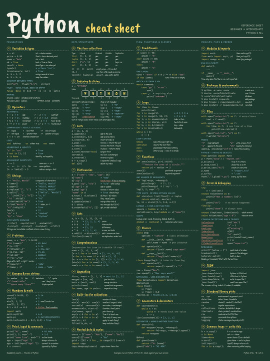</a> <b>08 · Chalkboard</b> Slate green with yellow, pink and blue chalk. <a href="posters/18x24/Python-Cheat-Sheet_08-Chalkboard_18x24_300dpi.png">18×24</a> · <a href="posters/20x24/Python-Cheat-Sheet_08-Chalkboard_20x24_300dpi.png">20×24</a> · <a href="posters/20x30/Python-Cheat-Sheet_08-Chalkboard_20x30_300dpi.png">20×30</a></td><td align="center" width="25%"><a href="posters/18x24/Python-Cheat-Sheet_09-Handheld_18x24_300dpi.png">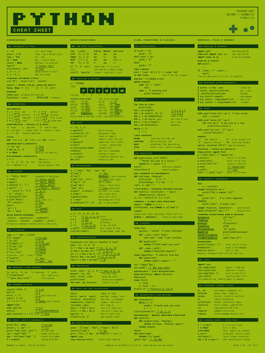</a> <b>09 · Handheld</b> Olive game screen with pixel type. <a href="posters/18x24/Python-Cheat-Sheet_09-Handheld_18x24_300dpi.png">18×24</a> · <a href="posters/20x24/Python-Cheat-Sheet_09-Handheld_20x24_300dpi.png">20×24</a> · <a href="posters/20x30/Python-Cheat-Sheet_09-Handheld_20x30_300dpi.png">20×30</a></td><td align="center" width="25%"><a href="posters/18x24/Python-Cheat-Sheet_10-Punch-Card_18x24_300dpi.png">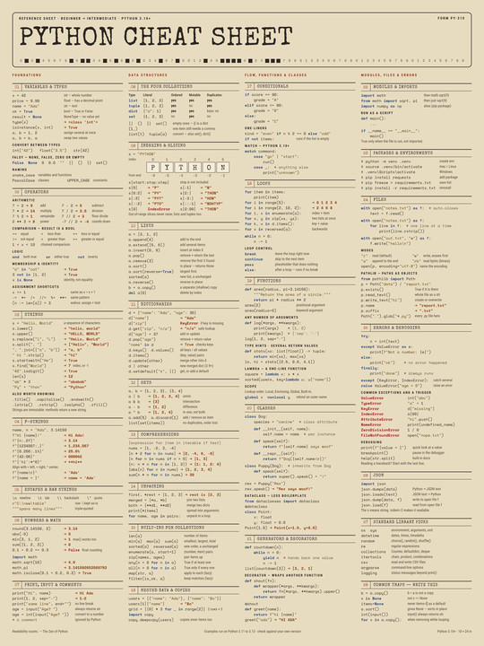</a> <b>10 · Punch Card</b> Manila punched card with typewriter heads. Light on ink. <a href="posters/18x24/Python-Cheat-Sheet_10-Punch-Card_18x24_300dpi.png">18×24</a> · <a href="posters/20x24/Python-Cheat-Sheet_10-Punch-Card_20x24_300dpi.png">20×24</a> · <a href="posters/20x30/Python-Cheat-Sheet_10-Punch-Card_20x30_300dpi.png">20×30</a></td><td align="center" width="25%"><a href="posters/18x24/Python-Cheat-Sheet_11-Marquee_18x24_300dpi.png">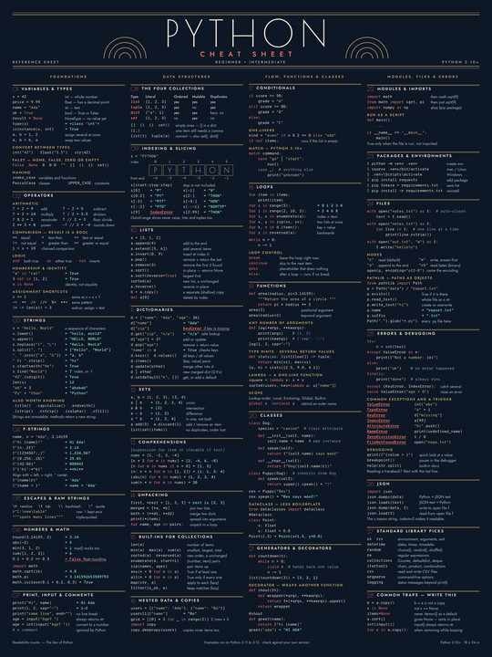</a> <b>11 · Marquee</b> Midnight navy with thin capitals, gold and coral. <a href="posters/18x24/Python-Cheat-Sheet_11-Marquee_18x24_300dpi.png">18×24</a> · <a href="posters/20x24/Python-Cheat-Sheet_11-Marquee_20x24_300dpi.png">20×24</a> · <a href="posters/20x30/Python-Cheat-Sheet_11-Marquee_20x30_300dpi.png">20×30</a></td></tr>
</table>

## Printing

Every file is a lossless PNG drawn at 300 dpi, in sRGB.

| Order this size | Use the file in | Pixels | What comes out |
|---|---|---|---|
| 18 × 24 in | `posters/18x24/` | 5400 × 7200 | The poster edge to edge, as designed. For any print shop that lists 18 × 24. |
| 20 × 24 in | `posters/20x24/` | 6000 × 7200 | The poster at exactly its 18 × 24 size, with 1 in of matching background left and right. Trim the sides to fit an 18 × 24 frame. |
| 20 × 30 in | `posters/20x30/` | 6000 × 9000 | The poster 11% larger (20 × 26.7 in), with a 1.7 in band of matching background above and below. |
| 24 × 36 in | `posters/20x30/` | 6000 × 9000 | The same file, one third larger than the original (24 × 32 in) with 2 in bands. Prints at 250 dpi. |

- **Walgreens and Sam's Club.** As of November 2026 neither lists 18 × 24 among its poster sizes. Both list 20 × 30 and 24 × 36, and Sam's Club also lists 20 × 24, so use a store-size file there. Uploading the 18 × 24 file to another size would crop it.
- **Before you pay,** check that the store's preview shows the whole sheet, from the title to the footer line, with nothing cut off.
- **Paper.** Matte hides glare on the dark themes. Swiss Grid, Notebook, Zen Garden, Playbill and Punch Card have light backgrounds and use far less ink.
- **Type size.** At 18 × 24 the code prints at about 10 pt and the smallest labels at 9 pt. At 24 × 36 that becomes about 13.5 pt and 12 pt.

## What's on the sheet

Twenty-eight reference sections in four columns, from a first variable to files, errors and common traps. Written for Python 3.10 and newer.

| Foundations | Data structures | Flow, functions & classes | Modules, files & errors |
|---|---|---|---|
| values, text and numbers | holding many values | deciding, repeating, reusing | the world outside your script |
| 01 Variables & types | 08 The four collections | 17 Conditionals | 22 Modules & imports |
| 02 Operators | 09 Indexing & slicing | 18 Loops | 23 Packages & environments |
| 03 Strings | 10 Lists | 19 Functions | 24 Files |
| 04 f-strings | 11 Dictionaries | 20 Classes | 25 Errors & debugging |
| 05 Escapes & raw strings | 12 Sets | 21 Generators & decorators | 26 JSON |
| 06 Numbers & math | 13 Comprehensions |  | 27 Standard library picks |
| 07 Print, input & comments | 14 Unpacking |  | 28 Common traps |
|  | 15 Built-ins for collections |  |  |
|  | 16 Nested data & copies |  |  |

**Reading a line:** code is on the left. An arrow (`→`) marks the *result* that line gives, an exception name such as `KeyError` marks the *error* it raises, and the smaller text beside it is a plain-words *note*.

## Folders

| Path | Holds |
|---|---|
| `index.html` | The preview page |
| `posters/18x24/`, `posters/20x24/`, `posters/20x30/` | Print files, twelve themes each |
| `previews/` | 1080 × 1440 previews |
| `thumbs/` | 540 × 720 thumbnails |

## Notes

Every example on the sheet was run on Python 3.11, 3.12 and 3.13. Check it against your own version. An independent reference, not affiliated with or endorsed by the Python Software Foundation. Python is a registered trademark of the Python Software Foundation.
